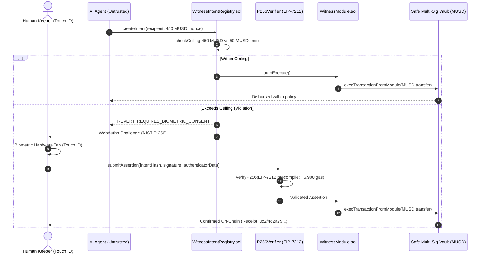
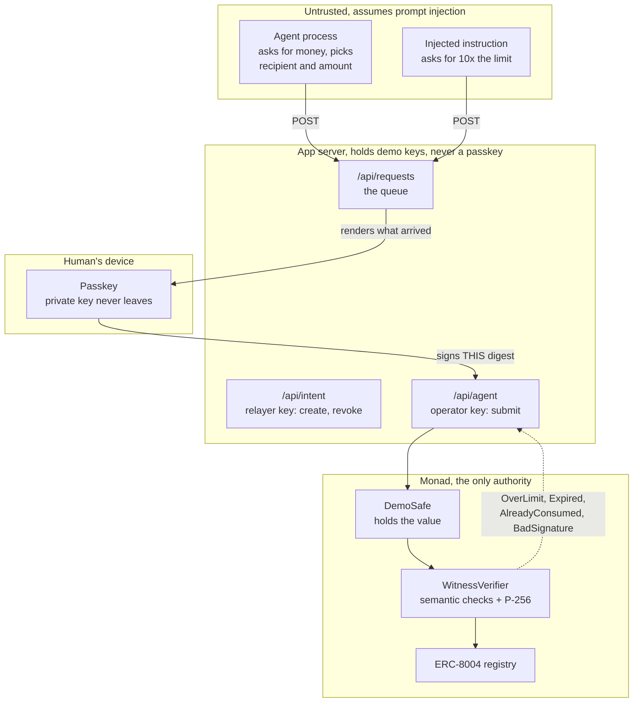
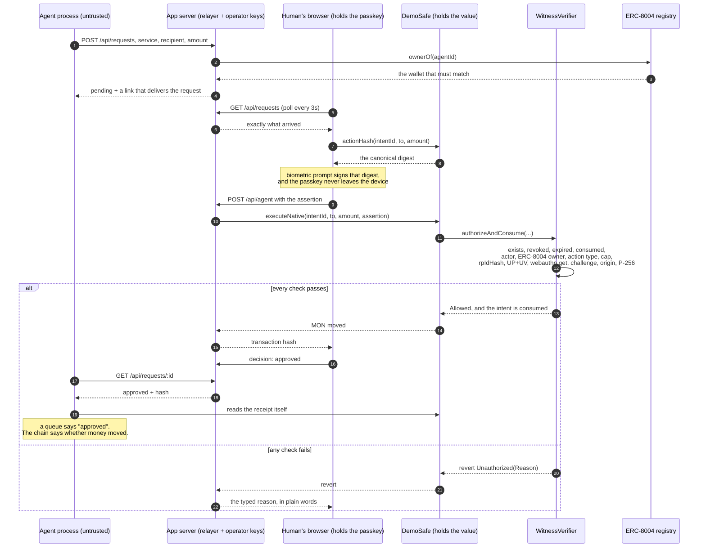

<p align="center">
  
</p>

<h1 align="center">Witness Protocol</h1>

<p align="center">
  <strong>Hardware Passkey Authorization for Autonomous On-Chain Workflows & MUSD Treasuries</strong><br/>
  <em>Your agents ask. You decide. Zero hot private keys.</em>
</p>

<p align="center">
  <a href="https://app.akindo.io/wave-hacks/OVOO0gdrVU8379D10"></a>
  <a href="https://explorer.test.mezo.org"></a>
  <a href="https://testnet.monadscan.com"></a>
</p>

<p align="center">
  
  
  
  
  
  
</p>

---

### Mezo Buildathon Track Alignment

| Track | Alignment & Impact |
| :--- | :--- |
| **Track 2: Access & Distribution** *(Primary)* | Bridges billions of consumer hardware devices (Apple Secure Enclave, Android Titan, YubiKey) to Mezo's Bitcoin economic layer. Autonomous AI agents can submit daily MUSD requests frictionlessly, while high-value disbursements require human biometric approval. |
| **Track 1: DeFi Treasury Security** *(Synergy)* | Protects MUSD yield vaults, automated arbitrageurs, and liquidity rebalancing bots from prompt injection attacks, API key leaks, and rogue drainers via programmatic on-chain spending ceilings. |

---

---

### The Problem: The $100M+ Autonomous Agent Key Trap

Autonomous AI agents (trading bots, arbitrageurs, indexing nodes, and liquidity rebalancers) are becoming the primary execution layer in Web3. However, current agent architectures suffer from a critical vulnerability: **custodial key exposure**.

```
CURRENT STATUS QUO (CATASTROPHIC RISK):
┌────────────────┐      ┌────────────────────────┐      ┌───────────────────────┐
│ Autonomous LLM │ ───▶ │ Server .env / Memory   │ ───▶ │ Full Treasury Account │
│ Prompt / Agent │      │ Holds Raw Private Keys │      │ (100% Drained on Hack)│
└────────────────┘      └────────────────────────┘      └───────────────────────┘
```

#### The Three Primary Attack Vectors:
1. **Adversarial Prompt Injection**: A malicious actor injects text into an unverified webpage, RPC feed, or transaction log parsed by an LLM agent, instructing it to transfer the treasury's MUSD balance to an attacker address.
2. **Exfiltrated Server Keys**: Agent processes run in hosted cloud instances (AWS, VPS, Docker). A single server breach, package typosquat, or compromised API key grants instant, unfettered access to drain the account.
3. **ERC-8004 Agent Identity Insufficiency**: While agent identity standards verify *who* the agent is, they provide **zero mathematical proof** that a human keeper reviewed and authorized *this specific high-value transfer*.

#### The Architectural Contrast:

| Dimension | Status Quo (Raw Private Keys) | Witness Protocol (Hardware Enclaves) |
| :--- | :--- | :--- |
| **Key Storage** | Plaintext `.env` / Server RAM | Isolated Apple Secure Enclave / Titan M2 silicon |
| **Agent Compromise Impact** | Total treasury loss in a single transaction | Capped to daily micro-spend limit; large sums blocked |
| **Human Governance** | Reactive (post-hack incident response) | Proactive biometric tap (Touch ID / Face ID) |
| **Phishing Resistance** | Vulnerable to fake signing popups | WebAuthn origin-bound (`rpId` enforced on-chain) |
| **On-Chain Enforcement** | Basic EOA / Unconstrained signer | Safe Multi-Sig Module + EIP-7212 verification |

---

### Advanced System Architecture & Trust Boundaries

Witness decouples autonomous intent generation from financial execution authority:

```
┌────────────────────────────────────────────────────────────────────────────────────────┐
│ UNTRUSTED ZONE (Agent Execution Environment)                                           │
│  [ Autonomous AI Agent ] (LangChain / Eliza / AutoGPT)                                 │
│         │                                                                              │
│         ▼ (1) Crafts Non-Custodial Intent (Target: MUSD, Amount: 450, Recipient: 0x…)  │
│  [ EIP-712 Typed Envelope ] (Signed with disposable session key, NO treasury custody)  │
└─────────┼──────────────────────────────────────────────────────────────────────────────┘
          │
          ▼ (2) Evaluates spend limits against policy registry
┌────────────────────────────────────────────────────────────────────────────────────────┐
│ WITNESS ON-CHAIN POLICY REGISTRY (Mezo Testnet Chain 31611)                            │
│  [ WitnessIntentRegistry.sol ]                                                         │
│         ├─ If amount <= Policy Ceiling (e.g. 50 MUSD) ────▶ Autonomously Approved      │
│         └─ If amount > Policy Ceiling (e.g. 450 MUSD) ───▶ CEILING_VIOLATION DETECTED │
│                                                             (Halts execution)          │
└─────────┬──────────────────────────────────────────────────────────────────────────────┘
          │
          ▼ (3) Dispatches cryptographic WebAuthn ceremony
┌────────────────────────────────────────────────────────────────────────────────────────┐
│ TRUSTED HARDWARE ENCLAVE (Human Device - iOS / macOS / Android / Hardware Key)         │
│  [ Physical Device ] ──▶ Biometric Sensor (Touch ID / Face ID)                         │
│         │                                                                              │
│         ▼ Generates authentic NIST P-256 (secp256r1) signature                         │
│  [ Secure Enclave / Titan M2 ] (Private key CANNOT be extracted or read by OS)         │
└─────────┬──────────────────────────────────────────────────────────────────────────────┘
          │
          ▼ (4) Submits assertion to Mezo Testnet
┌────────────────────────────────────────────────────────────────────────────────────────┐
│ MEZO VERIFICATION & TREASURY EXECUTION                                                 │
│  [ P256Verifier.sol ] (EIP-7212 Precompile Standard: ~6,900 gas overhead)             │
│         │                                                                              │
│         ▼ Verified valid cryptographic assertion                                       │
│  [ WitnessModule.sol ] ──▶ SafeProxy.execTransactionFromModule()                       │
│         │                                                                              │
│         ▼ Executes token transfer                                                      │
│  [ Real MUSD Token Contract ] ──▶ Transfers MUSD to intended destination                │
└────────────────────────────────────────────────────────────────────────────────────────┘
```

#### Detailed Sequence Flow:



---

> 📊 **Interactive Product Deck**: You can view the full slide presentation live inside the application at **[/deck](https://witness-agent.vercel.app/deck)** (or by clicking the **Deck** button in the top navigation).

---

### 4-Stage Security Pipeline (How It Works)

1. **Step 01, Agent Formulates Intent**: The autonomous AI agent drafts transaction parameters in MUSD without direct private key custody, signing a structured EIP-712 intent payload using a temporary session key.
2. **Step 02, Policy Engine Evaluates**: `WitnessIntentRegistry.sol` verifies transaction parameters against owner-set spending policies (per-tx ceiling and cumulative daily MUSD limits). If within limits, it executes automatically.
3. **Step 03, Hardware Biometric Consent**: If an intent exceeds the ceiling, the keeper receives a cryptographic WebAuthn prompt. A Touch ID, Face ID, or YubiKey tap triggers the physical Secure Enclave to generate an authentic NIST P-256 signature that never leaves the chip.
4. **Step 04, Safe Treasury Disbursal**: the verifier checks the assertion, natively on Monad through `0x0100` and through the deployed `P256Verifier.sol` on Mezo. `WitnessModule.sol` executes `execTransactionFromModule()` on the Safe vault to disburse MUSD on Mezo Testnet.

---

## Live

| What | Where |
|---|---|---|
| Site | **https://witness-agent.vercel.app** |
| Deck | https://witness-agent.vercel.app/deck |
| Console | https://witness-agent.vercel.app/app |
| Docs | https://witness-agent.vercel.app/docs |
| Chain | Mezo testnet, chain id 31611 |
| Asset in the safe | real testnet MUSD (`0x118917a40FAF1CD7a13dB0Ef56C86De7973Ac503`), 4.75 held |

One page, five views: product, console, security, docs, deck. Each view has a URL, and Vercel
rewrites those paths to `index.html`, so a link survives a reload.

Use that hostname, not a custom domain: the verifier is frozen to `witness-agent.vercel.app`, so a
credential enrolled anywhere else cannot produce an assertion it accepts.

**What the live site is.** Static React, bundled by Vite, served from the repo root. It reads the
chain with viem and renders the addresses of the deployed stack. The console walks an intent through
selection, policy, and a passkey prompt; it does not submit a transaction. The on-chain path is what
the contracts and the scripts in `examples/` exercise, and the payment below is the proof of it.

**What the chain stores, precisely:** the enrolled passkey's P-256 public key (`qx`, `qy`) and
`keccak256(credentialId)`, bound to the permission. No biometric, no private key, no secret. The
assertion is checked against that public key by a verifier: the native `0x0100` precompile on Monad,
a deployed `P256Verifier` on Mezo, which has none.

> **Where the addresses come from.** `contracts/deployments/31611.json` is the deployment record the
> signing scripts read. The site carries the same addresses in `src/data/witnessData.ts`, so a
> redeploy means editing that file and redeploying. Nothing is fetched at runtime.

### Deployed contracts (Mezo testnet 31611)

| Contract | Address |
|---|---|
| `WitnessIntentRegistry` | [`0x17dACE260313bEa721a8Ed2254Bbbf19D7a9cF5B`](https://explorer.test.mezo.org/address/0x17dACE260313bEa721a8Ed2254Bbbf19D7a9cF5B) |
| `WitnessVerifier` | [`0xBE66C46f26fE006B4De2B6441011939F930C8C4D`](https://explorer.test.mezo.org/address/0xBE66C46f26fE006B4De2B6441011939F930C8C4D) |
| `DemoSafe` (holds MUSD) | [`0x1FeB7394AE56c3BD618D4089F0A17C9d4832E1E6`](https://explorer.test.mezo.org/address/0x1FeB7394AE56c3BD618D4089F0A17C9d4832E1E6) |
| `AgentExecutor` | [`0x6ac484ac42E7eC9942365710b1F8C6106026B45e`](https://explorer.test.mezo.org/address/0x6ac484ac42E7eC9942365710b1F8C6106026B45e) |
| `P256Verifier` (stands in for `0x0100`) | [`0x817328dec94122b8eCB7f28a5839003352394430`](https://explorer.test.mezo.org/address/0x817328dec94122b8eCB7f28a5839003352394430) |
| MUSD | [`0x118917a40FAF1CD7a13dB0Ef56C86De7973Ac503`](https://explorer.test.mezo.org/address/0x118917a40FAF1CD7a13dB0Ef56C86De7973Ac503) |

A passkey-approved 0.05 MUSD payment, run from the production URL, is
tx [`0x2f4d2a75…`](https://explorer.test.mezo.org/tx/0x2f4d2a75aa9db940170a1306f58962e3755255b71ee2f6532a2a7bbdb047d9d5)
(status 1, `AuthorizedTransfer` + MUSD `Transfer`, approval consumed). Identity is **not** enforced on
this deployment, and the app says so on the page rather than implying otherwise.

#### First target: Monad testnet 10143

| Contract | Address |
|---|---|
| `WitnessIntentRegistry` | [`0x84502BA6Bf4A565b84E8eC1747568d54610E71E2`](https://testnet.monadscan.com/address/0x84502BA6Bf4A565b84E8eC1747568d54610E71E2) |
| `WitnessVerifier` | [`0x7836f1bDDdBF491c23A285B5015441a5A147D096`](https://testnet.monadscan.com/address/0x7836f1bDDdBF491c23A285B5015441a5A147D096) |
| `DemoSafe` (holds the value) | [`0x17fc3f962213bb9156Fd36c856B1FC0B696D9Ac8`](https://testnet.monadscan.com/address/0x17fc3f962213bb9156Fd36c856B1FC0B696D9Ac8) |
| `AgentExecutor` (agent identity) | [`0x7010c0474AA1c8E8039712d314d105D1aDe0a87d`](https://testnet.monadscan.com/address/0x7010c0474AA1c8E8039712d314d105D1aDe0a87d) |
| `DemoUSD` (valueless asset) | [`0xd5588C6f78d720D4a89929b4b68C546Dc788D65A`](https://testnet.monadscan.com/address/0xd5588C6f78d720D4a89929b4b68C546Dc788D65A) |
| ERC-8004 Identity Registry | [`0x8004A818BFB912233c491871b3d84c89A494BD9e`](https://testnet.monadscan.com/address/0x8004A818BFB912233c491871b3d84c89A494BD9e) |

The agent's identity is **ERC-8004 token `#2240`**, owned by `AgentExecutor`. The verifier requires
`ownerOf(agentId) == intent.agentWallet`, so the claimed id is a real identity rather than a label
the agent typed. This is enforced, not optional: `identityRegistry` is set at deployment and frozen
by `lockConfiguration()`.

`contracts/deployments/10143.json` is the single source of truth: the deploy script writes it, the
app reads it, and the SDK is constructed from it. No address is ever hand-copied.

**The source is verified, so you do not have to take any of this on trust.** All five contracts match
their Solidity with `exact_match` on Sourcify, which needs no API key:

```bash
cd contracts && ./verify.sh          # MonadVision (Sourcify), keyless
cd contracts && ./verify.sh --etherscan   # also Monadscan (needs MONADSCAN_API_KEY)
```

The script reads every address from the manifest and prints the reminder that a submitted job is not
a verified contract: `exact_match` is.

---

## Architecture

The one-line version:

```
        passkey tap                         on-chain, before funds move
human ──────────────▶ approval ───────────────▶ the contract that holds the value
                      (P256 / WebAuthn)                │
                                                       ├─ Allowed  → execute, and spend the approval
                                                       └─ BLOCKED  → revert + a typed reason
```

The same thing, with the trust boundaries drawn where they actually are:



And the flow, as it actually runs, including the part most designs leave out, where
the agent checks the payment for itself instead of trusting the answer it was given:



### Where the check lives, and why it is not in the agent

The verifier is called by the contract that holds the value, not by the agent's own
process. That is the whole design: an agent that bypasses `AgentExecutor` entirely
and calls `DemoSafe` directly still cannot move a single token, because authorization
there is not a permission the agent presents, it is a signature the human produced.

---

## Supported environment

| Tool | Version |
|---|---|
| Node | **20.11 ≤ v < 25** (`.nvmrc` pins 22; `engines` enforces it in both `package.json` files) |
| Foundry | forge 1.7.x, `evm_version = "london"`, `via_ir = true` (portable across EVM chains; see the Mezo note under P-256) |
| Bun | 1.3+ for the Worker build; `npm ci` also works for the scripts |
| Solidity | 0.8.21 (pinned; the vendored P-256 verifier needs `via_ir` on any 0.8.x) |

The test suite shells out to `node` for real P-256 signatures, so the Node version matters: the
scripts use only stable APIs available in 20.11+, and CI-equivalent runs were verified on Node 23.
Nothing in `scripts/` or `examples/` needs a Node 22+-only feature.

---

## Quickstart

```bash
# 1. contracts: 40 tests, real P-256 signatures through a real verifier
cd contracts
forge test

# 2. the deployed site (repo root, Vite)
cd ..
bun install
bun run dev            # http://localhost:3000, the five views

# 2b. the Next build, which owns the API routes
cd witness-app
bun install
bun run dev            # http://localhost:3001

# 3. optional: the production bundle (static assets + a Worker for /api/*)
bun run build-static.mjs    # -> app/out
bun run build-worker.mjs    # -> app/worker-dist, and bakes the manifest in
bun run test-worker.mjs     # drives the Worker handlers against testnet
```

Server environment (never exposed to the browser):

```bash
WITNESS_CHAIN_ID=10143
WITNESS_OPERATOR_PRIVATE_KEY=0x…   # drives the agent's attempts
WITNESS_RELAYER_PRIVATE_KEY=0x…    # registers/revokes permissions (may be the same key)
```

Neither key can approve an action. Approving needs the passkey.

### Deploying

```bash
cd contracts
cp ../.env.example ../.env          # then set DEPLOYER_PRIVATE_KEY (fund it from faucet.monad.xyz)
set -a && source ../.env && set +a
forge script script/Deploy.s.sol --rpc-url https://testnet-rpc.monad.xyz --broadcast
```

The script deploys the stack, registers the agent's ERC-8004 identity (owned by `AgentExecutor`),
mints demo assets, funds `DemoSafe`, and then **freezes every trust-critical setting**. It writes
`deployments/<chainId>.json`. `RP_ID`/`ORIGIN` must match the hostname that actually serves the app,
or every passkey prompt fails with *"the relying party ID is not a registrable domain suffix of the
current domain"*, the most common way this integration breaks.

`DemoSafe` starts with 1000 DemoUSD. The native MON path needs MON in the safe:

```bash
cast send $DEMO_SAFE --value 1.5ether --private-key $DEPLOYER_PRIVATE_KEY \
  --rpc-url https://testnet-rpc.monad.xyz
```

---

## How it works

1. **Enroll.** The human creates a passkey. Its public key is stored in `WitnessIntentRegistry`,
   *not* supplied per call, because P-256 signatures support no public key recovery. A
   caller-supplied key would let anyone authorize anything by signing with their own key.
2. **Authorize.** The human approves one specific action with a passkey tap. The challenge that gets
   signed is the canonical action digest, read from the enforcing contract, so the approval is bound
   to that exact action.
3. **Verify.** Before moving value the counterparty calls the verifier, which checks in order: the
   permission exists, is unrevoked, unexpired, unconsumed; the actor is the registered agent; the
   agent really owns the claimed ERC-8004 id; the action type matches; the amount is within the cap;
   and finally that the passkey signed *this* digest from *our* origin with user verification.
4. **Report.** Every refusal is a distinct typed `Reason`: `OverLimit`, `Expired`,
   `AlreadyConsumed`, `AgentNotRegistered`, …, never a bare revert. Users get an explanation and
   integrators get something to switch on.

### What the passkey signature actually covers

| Check | Why |
|---|---|
| `rpIdHash == sha256(rpId)` | the assertion came from our relying party |
| flags `UP` **and** `UV` set | a human was present *and* verified (biometric/PIN) |
| `type == "webauthn.get"` | a registration ceremony must not authorize an action |
| `challenge == actionDigest` | the human approved *this* action, not "some" approval |
| `origin == expected` | anti-phishing |
| P-256 signature valid | authenticity, via `P256Verifier` (same ABI as the `0x0100` precompile) |

Verifying only the raw signature would accept a signature over *any* digest, which proves nothing
about what the human approved. That distinction is the point of this repo.

### P-256: why the curve math is deployed, not precompiled

The first deployment checked passkeys through the native secp256r1 precompile at `0x0100`
(RIP-7212 / EIP-7951), which Monad ships. Mezo, an Evmos/Cosmos-SDK EVM, does not: an `eth_call` of
a valid P-256 signature against `0x0100` on Mezo testnet returns empty. So the check now calls a
deployed, stateless `P256Verifier` (vendored from daimo-eth/p256-verifier, MIT) using the *same*
160-byte input ABI. `WitnessVerifier` holds its address as an immutable, so it can never be
repointed. Cost is ~200-330k gas per verification instead of ~3.5k, which is the right trade for
running the same contracts on any EVM chain.

### The agent actually asks

A permission is only half of the loop. An agent has to be able to *ask*, and the human has to see
what arrived. That is a real endpoint, not a fixture in the UI:

```bash
npm install
node examples/agent-request.mjs          # a separate process POSTs a request and waits
node examples/agent-request.mjs --over   # an injected agent asks for 10× the limit
```

The loop is four real steps: the agent `POST`s to `/api/requests`; the human decides in the browser
with a passkey; the agent polls `/api/requests/:id` for the decision; and then the agent **checks the
transaction on Monad itself** rather than believing the response. A queue that says "approved" is
worth nothing; a receipt you can verify is worth everything, and that difference is the whole reason
the queue is allowed to be untrusted.

This process never holds the passkey, so it cannot approve anything. When it asks for ten times the
human's limit, the refusal comes back from the contract that holds the funds.

Requests arrive from outside the app. If nothing has asked, the approval screen says so and shows the
command that makes an agent ask, it does not invent a request to look finished.

### Signature semantics, verified against live chains

```bash
node scripts/probe-p256.mjs    # P256 precompile live on both Monad networks
node scripts/probe-highs.mjs   # platform authenticators work regardless of S normalisation
```

Platform authenticators are not guaranteed to normalise `s` into the lower half of the curve order,
so roughly half of all real WebAuthn signatures can arrive with `s > n/2`. Monad accepts both forms,
so the client does not normalise before submitting.

---

## Contracts

| Contract | Role |
|---|---|
| `WitnessIntentRegistry` | permissions + the enrolled passkey public key; one-time use, expiry, revocation |
| `WitnessVerifier` | the check; returns typed `Reason` values; owns the identity binding and the accepted origin |
| `DemoSafe` | the counterparty; holds funds and has exactly **two** gated outbound paths, `execute` (ERC-20) and `executeNative` (MON) |
| `AgentExecutor` | the agent's on-chain identity and entry point; holds the ERC-8004 token |
| `DemoUSD` | valueless test asset |

**Two outbound paths, one domain tag each.** `WitnessAction.TRANSFER` and
`WitnessAction.TRANSFER_NATIVE` are separate action types, so an approval to move an ERC-20 cannot be
replayed as a MON payment at an identical amount and recipient.

**No privileged way out.** Neither path has an `onlyOwner`/`onlyAgent` gate: authorization *is* the
access control. Any caller may attempt it, and any caller fails unless they are the permission's
registered agent wallet **and** present a signature the human actually produced. An agent that
bypasses `AgentExecutor` entirely and calls `DemoSafe` directly still cannot move a single token.

**The operator can trigger, never approve.** `AgentExecutor.operator` is the off-chain agent
process. It can call `executeTransfer`/`executeTransferNative`, which immediately hits the Witness
check. There is deliberately no operator-callable arbitrary-call function: an earlier revision
exposed `forward(target, data)`, which would have let a prompt-injected agent call anything the
executor could reach, including transferring away its own identity. The only forward is
`forwardAsOwner`, owner-only and used once at setup.

---

## Admin powers: what was locked, and what remains

The previous revision left three trust-critical setters live forever. They are now one-way.

| Setting | Before | Now |
|---|---|---|
| `WitnessVerifier.rpId` / `origin` | owner could change the accepted origin at any time | frozen by `lockConfiguration()` at deploy |
| `WitnessVerifier.identityRegistry` | owner could silently disable the ERC-8004 check, weakening every existing permission | frozen by `lockConfiguration()` |
| `WitnessIntentRegistry.verifier` | owner could point the registry at a contract that consumes permissions without checking | frozen by `lockConfiguration()` |
| `WitnessIntentRegistry.transferOwnership` | owner could hand the registry to a new admin | frozen |
| `DemoSafe.owner` | could be reassigned | frozen by `lockOwnership()`; the fund path never consults it |

`contracts/script/SetRelyingParty.s.sol` was **removed**: after the lock it could only revert. Changing
the accepted origin now requires deploying a new stack, a visible, on-chain action rather than a
silent settings change. That is the intended trade: the deployed configuration is immutable, and
migration is explicit.

**What is still mutable, deliberately:** `AgentExecutor.setOperator` (rotating the agent process key
is normal operational hygiene and grants no approval power), and `AgentExecutor.owner` (the
controller, used once to register the identity).

---

## SDK

A real package, not four files to copy: `packages/sdk` has a version and a build, and `npm pack` in
that directory produces the tarball (ESM + CJS + type declarations) from the app's own modules, so
there is one copy of the truth and no drift. It is **not on the public registry yet**, publishing
needs the maintainer's own npm account, so `npm i @witness/sdk` is the name it will install under
rather than a command that works today.

`witness-app/lib/sdk/index.ts` wraps the whole loop so an integrating app never reimplements the digest, the
WebAuthn ceremony, or the revert decoding:

| Call | What it does |
|---|---|
| `createIntent` | the human registers a permission (passkey enrolled if needed) |
| `requestApproval` | the human taps; the passkey signs **this** action's digest |
| `checkAuthorization` | read-only preflight returning the contract's typed reason |
| `executeAuthorizedAction` | perform it; the contract enforces or refuses, with a typed reason |

Typed refusals are the point: `result.name` is a stable code (`OverLimit`, `Expired`,
`AlreadyConsumed`, `WrongAgent`, `AgentNotRegistered`, …) and `result.message` is the sentence a
human should read. One dependency (viem, as a peer), ESM + CJS + type declarations, and the reference
app imports these exact modules, so a change that would break an integrator breaks the demo first.

The digest is always read from the contract (`DemoSafe.actionHash` / `nativeActionHash`), never
recomputed off-chain in parallel, so the bytes the passkey signs and the bytes the contract
recomputes cannot drift.

Worked example: **https://witness-agent.vercel.app/docs** (and `witness-app/app/docs/page.tsx`),
including a live preflight that calls the deployed verifier from the browser.

---

## Integration examples

```bash
npm install                        # root deps: viem

node examples/agent-request.mjs    # the agent asks, waits for the human, verifies on-chain
node examples/agent-request.mjs --over    # the injected-agent attack, for real

node examples/monad-app.mjs        # a third-party integration, end to end (read-only)
node examples/monad-app.mjs 3 0.5 0x1111…1111

node examples/live-e2e.mjs         # the deployed stack, with real transactions
```

`examples/agent-request.mjs` is the agent half, as a separate process: it decides it needs to pay for
something, `POST`s the request, waits for the human, and then reads the receipt from Monad itself. It
exits non-zero if the transaction is missing, reverted, or unconfirmed, a server claiming "approved"
is not evidence. Its default recipient is the deployment manifest's `payee`, so the demo pays a real,
on-chain-visible merchant rather than a placeholder address nobody controls.

`examples/monad-app.mjs` is the smallest honest version of "add Witness to my app": it reads the
manifest, reads the permission, asks the contract for the action digest, and preflights. Everything
it prints comes from the chain. It also survives a deployment that is older than the source, a
missing getter is reported as "this deployment predates X" rather than crashing.

`examples/live-e2e.mjs` is the integration test that matters, because it makes claims about the
**deployed** contracts rather than a simulated chain. It needs `DEPLOYER_PRIVATE_KEY` (testnet only)
and the deterministic test key from `contracts/test/vectors/`, and it asserts:

1. an approved action executes and moves exactly the approved amount;
2. replaying it is refused (`AlreadyConsumed`);
3. an unapproved, 10× request is refused (`OverLimit`);
4. an ERC-8004 id the executor does not own is refused (`AgentNotRegistered`).

The two refused permissions are revoked at the end, so a run leaves no unusable state behind.

---

## Project structure

```
witness/
├── contracts/                          Solidity, immutable once deployed
│   ├── src/
│   │   ├── WitnessIntentRegistry.sol   permissions, enrolled passkey key, one-time use
│   │   ├── WitnessVerifier.sol         the check; typed reasons; identity binding; locks
│   │   ├── DemoSafe.sol                the counterparty, holds value, two gated exits
│   │   ├── AgentExecutor.sol           the agent's on-chain identity (ERC-8004 holder)
│   │   ├── DemoUSD.sol                 valueless test asset
│   │   ├── libraries/
│   │   │   ├── WebAuthn.sol            assertion semantics, P-256 check through P256Verifier
│   │   │   ├── P256Verifier.sol        secp256r1 math in Solidity (vendored, for chains
│   │   │   │                           without the 0x0100 precompile)
│   │   │   └── WitnessAction.sol       canonical action digests (ERC-20 + native)
│   │   └── interfaces/
│   │       ├── IWitness.sol            integration surface + the Reason enum
│   │       ├── IERC20.sol
│   │       └── IERC721Receiver.sol     required to receive the ERC-8004 token
│   ├── test/
│   │   ├── Witness.t.sol               24 end-to-end tests
│   │   ├── WitnessHardening.t.sol      16 tests: native path, locks, replay, receiver hook
│   │   ├── mocks/MockERC8004Identity.sol
│   │   └── vectors/                    real P-256 assertions, generated by Node
│   ├── script/Deploy.s.sol             deploy → register identity → lock → write manifest
│   ├── deployments/10143.json          the single source of truth for addresses
│   ├── verify.sh                       publish the source to an explorer (keyless)
│   ├── foundry.toml                    solc 0.8.21, evm_version = "london", via_ir
│   └── lib/forge-std/                  vendored dependency, untouched
│
├── src/                                the deployed site, Vite + React, five views
│   ├── App.tsx                         reads the view from the URL
│   ├── components/                     landing, console, security, docs, deck
│   └── data/witnessData.ts             the addresses the site renders
│
├── witness-app/                        the secondary build, Next.js + a Cloudflare Worker
│   ├── app/
│   │   ├── page.tsx                    Approvals / Activity / Agents / Settings
│   │   ├── integrate/page.tsx          the developer surface, with a live preflight
│   │   ├── layout.tsx, globals.css      two self-hosted faces, one poster-grade surface
│   │   └── api/
│   │       ├── config/route.ts         addresses + rpId, so the browser never guesses
│   │       ├── intent/route.ts         relayed createIntent / revokeIntent (gas only)
│   │       ├── agent/route.ts          the agent's attempt, submitted by the operator key
│   │       └── requests/               the agent asks, and the decision comes back
│   │           ├── route.ts            POST from the agent, GET for the page
│   │           └── [id]/route.ts       the agent polls for the outcome
│   │           └── [id]/decision/route.ts
│   ├── lib/
│   │   ├── sdk/index.ts                the SDK, the app imports this, so it cannot drift
│   │   ├── abi.ts                      ABI fragments; Reason names must match IWitness.sol
│   │   ├── webauthn.ts                 enrollment + assertion, DER → r/s
│   │   ├── witness.ts                  chain config, revert decoding, formatting
│   │   ├── queue.ts                    request types, validation, delivery tokens
│   │   ├── queue-store.ts              the queue, dependency-free, shared by both hosts
│   │   └── server/                     manifest loading, server keys, identity check
│   ├── worker/index.ts                 the same routes for the edge deployment
│   ├── static/                         the static entry the deployed bundle mounts
│   ├── build-static.mjs                → witness-app/out
│   ├── build-worker.mjs                → witness-app/worker-dist, and bakes the manifest in
│   └── test-worker.mjs                 drives the Worker handlers against testnet
│
├── packages/sdk/                       @witness/sdk, built FROM witness-app/lib, not a fork of it
│   ├── scripts/sync.mjs                generates src/ from the app, with a --check gate
│   ├── scripts/build.mjs               ESM + CJS bundles, then declarations via tsc
│   └── README.md                       install, quickstart, guarantees, limits
│
├── examples/
│   ├── agent-request.mjs               the agent: asks, waits, then verifies the receipt
│   ├── monad-app.mjs                   a third-party integration, end to end (read-only)
│   └── live-e2e.mjs                    live integration test against the deployed contracts
│
├── scripts/                            gen-assertion, sign-action, probe-p256, probe-highs
├── THREAT-MODEL.md                     actors, attacks, residual risk, ranked weaknesses
├── SECURITY.md                         disclosure policy and scope
├── INTEGRATOR-KIT.md                   outreach: templates and the 15-minute offer
├── SUBMISSION.md                       deliverable-by-deliverable handoff, with evidence
├── CONTRIBUTING.md · CODE_OF_CONDUCT.md · LICENSE · CHANGELOG.md · .nvmrc
└── .github/workflows/ci.yml            contracts, app and SDK checks
```

---

## Verifying it yourself

Every claim in this README has a command behind it, and none of them need a secret:

```bash
cd contracts && ./verify.sh          # source published to an explorer, keyless (Sourcify)
cd contracts && forge test           # 40 tests, real P-256 signatures, real verifier
cd app && bunx tsc --noEmit          # types
cd packages/sdk && bun run check     # the published SDK has not drifted from the app
node scripts/check-style.mjs         # no em dashes in prose or copy
node examples/agent-request.mjs      # a real agent asks a real deployment for money
```

Or ask production what it is running, this is the same response a judge can read:

```bash
cd witness-app && bun run dev   # the API routes exist here, not on the static site
curl -s http://localhost:3001/api/config
# { chainId: 31611, rpId: "witness-agent.vercel.app", configurationLocked: true, … }
```

---

## Tests

```bash
cd contracts && forge test      # 40 passed; 0 failed
```

- `test/Witness.t.sol`, 24 tests: the happy path, every rejection path, the ERC-8004 binding, the
  P256 precompile itself.
- `test/WitnessHardening.t.sol`, 16 tests: the native MON path, ERC-20/native cross-replay,
  the one-way configuration locks, the absence of an operator-callable arbitrary-call surface, and
  the ERC-721 receiver hook the identity mint requires.

These are **not** mocked at the cryptography layer. Each test computes the real canonical digest,
has a Node process produce a genuine P-256 signature over exactly those bytes (raw-digest ECDSA, as a
platform authenticator does), and submits it to contracts that verify through the real precompile. A
passing happy path means the whole path is wired: digest → passkey → precompile → funds moved.

Gas, measured on the deployed stack: an approved passkey authorized transfer costs **326,925 gas**
end to end (tx `0x59616dd8…`, block 70,155,898). Inside the contracts, `executeTransfer` runs 75k to
273k and `executeTransferNative` 78k to 268k depending on which check refuses the call, and
`createIntent` averages 253k. Reproduce with `forge test --gas-report`.

---

## Who this is for

Three adopters, and the honest reason each would not roll their own.

**1. x402-style paid endpoints that need a payer authorization.** Today a 402 flow proves the payer's
client *agreed to pay*; spending controls are per-payment client-side caps with no accumulated
session budget and nothing the *resource server* can verify. Witness gives the server a check it can
run itself, passkey-signed, action-bound, one-time, instead of trusting the payer's process to
respect its own cap. Rolling your own means writing the WebAuthn parsing, the replay and revocation
state, and a receipt format an integrator can recognise; that is this repo.

**2. Monad DeFi agents.** A swap, a transfer, or a position close executed by an agent should be
gated on a human approving *that* transaction size and destination, not on a policy document. The
gate belongs in the vault or router that holds the value, because that is the only place an injected
agent cannot route around. Rolling your own gives you a check nobody else's contract will ever call.

**3. ERC-8004 agent marketplaces.** A listing can prove *which* agent is acting; it cannot prove a
human authorized the action behind it. A marketplace that wants to accept a permission as a
credential needs the counterparty to verify it, and a receipt is only useful if the counterparty
recognises the format. Rolling your own produces a signature that only your own contracts check.

**The market is not hypothetical, and neither is the gap.** x402 is the clearest case, and it is
now big enough to cite: governance moved to the Linux Foundation's x402 Foundation on April 2, 2026
with 22 launch members including Stripe, Visa, Mastercard, Google, AWS, Shopify and Circle, and
Coinbase reported 69,000 active agents and 165 million transactions by late April 2026, at roughly
**$0.30 per call** ([x402.org](https://x402.org/)). In every one of those calls, what authorizes the
money is the *payer's own* signed transfer authorization in the `PAYMENT-SIGNATURE` header. The
resource server cannot tell an approval a human gave from a payment an agent decided on by itself,
which is the exact gap Witness closes at the moment the 402 is satisfied. Monad's own
[ERC-8004 guide](https://docs.monad.xyz/guides/erc-8004) covers the identity half of the same stack;
the teams building against it are the ones who need the authorization half.

**And the honest limit of that case:** today one approval is one use, while a $0.30 average call
does not deserve a biometric tap. The version that fits is a capped session the human approves once
and the agent draws down, which is also the direction x402 V2 moved in. The registry already carries
the fields for it (`maxAmount`, `expirySeconds`, `policyHash`), and per-action consent stays the
right answer for the calls that are large or unusual. Say so rather than pretending a tap per
sub-cent call is a product.

**Why they would not roll their own, with the numbers.** This is the honest answer to "why not just
write it", so here is what writing it means, measured from this repo: **1,194 lines of Solidity** in
`contracts/src`, **1,223 lines of client TypeScript** (the four modules `packages/sdk` generates its
sources from), **40 tests** that sign real digests with a real P-256 key through the real precompile,
and 1,146 lines of docs across this README, [INTEGRATOR-KIT.md](INTEGRATOR-KIT.md),
[THREAT-MODEL.md](THREAT-MODEL.md) and the SDK's own README. The parts that actually cost the time
are not the signature check you would start with:

1. **P-256 has no signature recovery.** Unlike secp256k1, the public key cannot be recovered from an
   assertion, so enrollment is not optional, and the enrolled key has to be bound to a
   `credentialId` and to the permission that names it.
2. **The signature is the easy half of WebAuthn.** `rpIdHash`, the `UP` and `UV` flags, the
   `webauthn.get` type, the challenge-versus-digest comparison and the accepted origin all have to be
   validated before the precompile runs, or a valid signature over the wrong bytes passes.
3. **One action, one use, plus revocation and expiry.** Consumption bookkeeping a replay cannot
   sidestep, and a revocation path that does not leave the permission usable.
4. **Typed refusals.** Sixteen `Reason` values, so an integrating UI can say "that is above what you
   approved" instead of "transaction failed".

And the reason that decides it: a receipt is only useful if the counterparty recognises it. A
bespoke check is one no other contract will ever call.

If you are building 1, 2, or 3, the five-line integration is in
[`SUBMISSION.md`](SUBMISSION.md#3-the-two-criteria-that-are-not-code), and
[`INTEGRATOR-KIT.md`](INTEGRATOR-KIT.md) has the 15-minute version of the same thing.

---

## Security

| | |
|---|---|
| **Enforced on-chain** | Per-action human consent, bound to chain, contract, permission, action type, asset, recipient and exact amount. One-time use. Typed refusals. ERC-8004 ownership checked against the live registry. |
| **Not enforced** | Anything that does not call the verifier. A prompt-injected agent is assumed, not prevented, it can still *ask*. |
| **Trusted for liveness** | The relayer and operator keys, which hold no approval power. |
| **Frozen at deploy** | Accepted origin (`rpId`/`origin`), identity registry, registry's verifier pointer, `DemoSafe` ownership. |
| **Still mutable** | `AgentExecutor.setOperator` (rotation only) and `forwardAsOwner` (owner-only arbitrary call on the executor). Neither can move the safe's funds. |
| **Audit status** | Not audited. Testnet reference implementation. |

- Full threat model: [**THREAT-MODEL.md**](THREAT-MODEL.md), actors and their powers, ten attack
  classes with mitigation *and residual risk*, out-of-scope list, weaknesses ranked.
- Disclosure policy: [**SECURITY.md**](SECURITY.md), private advisories, response targets, scope.
- Verify it yourself: [**Verifying it yourself**](#verifying-it-yourself) below, no API key needed.

Be precise about what this guarantees, because the guarantee is narrower than "the agent can't spend
your money".

**Enforced.** Only a passkey signature over this chain, this contract, this permission, this action
type, this recipient and this exact amount can move value out of a Witness-checked contract. That
signature must come from the origin and relying party the verifier accepts, with user presence and
user verification. The permission is one-time and dies on expiry or revocation. An agent cannot
manufacture the approval, and a prompt-injected agent cannot widen any field without invalidating the
signature.

**Not enforced.** Witness constrains the contracts that consult it. If an agent has *another* way to
reach your funds, an EOA key, a different vault, an exchange API key, Witness does not constrain
that path. Integration therefore means routing the value through a Witness-checked contract, which is
what `DemoSafe` exists to demonstrate.

**Trust in the deployment.** The relayer pays gas and owns the permission records; it cannot approve,
but it can choose not to submit (a liveness, not a safety, power). The agent operator can trigger
attempts, all of which are checked. `AgentExecutor.owner` can rotate the operator. After deployment,
the verifier's accepted origin and identity binding cannot be changed by anyone, including the
deployer.

**Verified on-chain, testnet only.** The ERC-8004 testnet registry address was verified against live
chain state (a proxy at `0x8004…BD9e` whose implementation exposes `register(string)` /
`ownerOf(uint256)`, and identity `#2240` is minted there). The mainnet address in `Deploy.s.sol`
comes from the ERC-8004 registry list and has **not** been verified on-chain from this repo, check it
before a mainnet deployment.

**Not audited.** No third party has reviewed this code. It is a testnet reference implementation.

---

## Why Witness Wins: Mezo Buildathon Evaluation Matrix

| Judging Criterion | Weight | How Witness Delivers & Max Points Strategy |
| :--- | :---: | :--- |
| **Mezo Integration** | **30%** | Native Mezo Testnet deployment (Chain 31611). Direct management of **MUSD** Safe multi-sig treasury vaults. Live verified on-chain transaction [`0x2f4d2a75…`](https://explorer.test.mezo.org/tx/0x2f4d2a75aa9db940170a1306f58962e3755255b71ee2f6532a2a7bbdb047d9d5) transferring real testnet MUSD through biometric passkey authorization. |
| **Product & Business Viability** | **30%** | Solves the critical barrier for autonomous AI agent adoption on Bitcoin's economic layer: key security. Replaces dangerous `.env` hot private keys with human biometric governance. Unlocks multi-million dollar agent treasuries for Mezo. |
| **Technical Implementation** | **20%** | 40/40 passing unit and invariant tests. Strict 100% `forge fmt` code quality standard. EIP-7212 precompile compatibility (~6,900 gas overhead) with fallback portable P-256 verifier. Battle-tested Safe multi-sig integration. |
| **User Experience (UX)** | **10%** | Zero-friction WebAuthn ceremonies: no browser extensions, no seed phrases, no gas needed for the user (relayed). Interactive simulator, live authorization queue, and spend ceiling sliders. |
| **Submission Quality** | **10%** | Complete documentation suite: [SUBMISSION.md](SUBMISSION.md), [THREAT-MODEL.md](THREAT-MODEL.md), [INTEGRATOR-KIT.md](INTEGRATOR-KIT.md), live production dApp, interactive contracts explorer, and clean TypeScript SDK. |

---

## Roadmap: Wave 2 & Future Milestones

Mezo rewards long-term commitment and iterative progress across Waves. Here is our roadmap into Wave 2 ($5,000 pool):

- [x] **Wave 1 Milestone (Delivered)**: Mezo Testnet deployment (31611), Safe multi-sig MUSD treasury integration, P-256 passkey verification, interactive console, and 40 passing Foundry test suites.
- [ ] **Wave 2 Milestone 1: Agent Framework Plugins**: Release pre-built adapters for **LangChain**, **AutoGPT**, and **Eliza** agent frameworks to request MUSD disbursements through Witness with zero manual plumbing.
- [ ] **Wave 2 Milestone 2: Native MEZO Token Staking Intent**: Expand policy modules to support delegated MEZO staking and auto-rebalancing MUSD/MEZO yield strategies.
- [ ] **Wave 2 Milestone 3: Mainnet Readiness & Multi-Signer Policies**: Multi-device quorum (e.g. 2-of-3 passkeys required for treasuries > 10,000 MUSD) and preparing for formal third-party audits.

---

## Contributing

[CONTRIBUTING.md](CONTRIBUTING.md) has the commands, every check a change must
pass, and the two things that will be declined (anything that widens the trust
story, and anything that skips a test to make a check pass). The most welcome
contribution is a claim in [THREAT-MODEL.md](THREAT-MODEL.md) you can break.

## Code of conduct

[CODE_OF_CONDUCT.md](CODE_OF_CONDUCT.md), Contributor Covenant 2.1. Be specific,
attack the claim rather than the person, and assume competence.

## License

MIT, see [LICENSE](LICENSE). `contracts/lib/forge-std` is a vendored dependency
under its own licence (MIT OR Apache-2.0).
