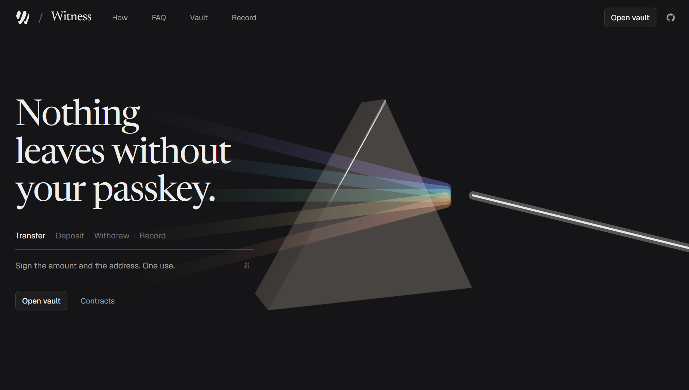
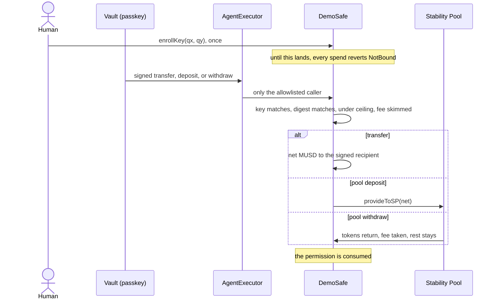

<p align="center">
  
</p>

<h1 align="center">Witness</h1>

<p align="center">
  Passkey approvals for a treasury.<br/>
  Software can ask. Only a signature spends.
</p>

<p align="center">
  <a href="https://witness-agent.vercel.app">Site</a>
  ·
  <a href="https://witness-agent.vercel.app/app">Vault</a>
  ·
  <a href="https://witness-agent.vercel.app/deck.pdf">Deck</a>
  ·
  <a href="https://explorer.test.mezo.org">Mezo testnet</a>
  ·
  <a href="WAVE2.md">Wave 2 notes</a>
</p>

<p align="center">
  
  
  
  
</p>

<p align="center">
  
</p>

The mark is a geometric W, the same one as the tab icon.

## Live

| | |
|---|---|
| Site | https://witness-agent.vercel.app |
| Vault | https://witness-agent.vercel.app/app |
| Deck | https://witness-agent.vercel.app/deck.pdf |
| Contracts | https://witness-agent.vercel.app/security |
| Chain | Mezo testnet, chain id 31611 |
| Safe | Started at 100 testnet MUSD. After a 1 MUSD transfer and a pool round trip, it holds just under 99 (fees are taken from each signed amount). Fee 10 bps. Admin locked. |
| Passkey | Enrolled. One key, on `witness-agent.vercel.app`. |

Enroll on that hostname. The verifier is frozen to `witness-agent.vercel.app`. A passkey created anywhere else will not verify. `enrollKey` is one shot, and it has already been used on the recorded vault. A different passkey can open its own vault from the page. That does not touch this one.

The site is a Vite app with three views: Overview, Vault, Record. `/api/relayer` pays gas. It cannot approve.

## Shown on Mezo

Recorded 6 Nov 2026. The fee came out of each signed amount.

| | |
|---|---|
| Deposit, 1 MUSD | [0x66f8a5ae…070a2](https://explorer.test.mezo.org/tx/0x66f8a5aec0e25ca2865d317fad4a59f04bae79d6c1fd6fbe0ac64d58a24070a2). 0.999 MUSD went into the Stability Pool. |
| Transfer, 1 MUSD | [0xdefbe4c3…1c77c](https://explorer.test.mezo.org/tx/0xdefbe4c371f86f039a466c6f527d0c1129fe5736867fe46e00909a8e13e1c77c). Intent 6 is consumed. |
| Above the ceiling | Refused. The contract returned OverLimit. Nothing moved. |
| Withdraw | [0xd6b0ab45…e53f](https://explorer.test.mezo.org/tx/0xd6b0ab45091b7836de162816e9565a6c066db6f41bbd9bda097bca515be9e53f). Intent 8 is consumed. The pool returned the deposit to the vault, less the fee. |
| A different passkey | [0x38650d3a…ca7](https://explorer.test.mezo.org/tx/0x38650d3a1708aabc4705fbdecf3489be9560bf266d4d5c1ebea8f82caf0d4ca7). A second browser's passkey opened its own vault and deposited 1 MUSD. The recorded vault was not touched. |

## Mezo Borrow: a trove the passkey guards

A second vault owns a Mezo trove. Opening it, adding BTC collateral, and repaying MUSD each go through Mezo's `BorrowerOperations`, and each needs the enrolled passkey over that exact action, from the allowlisted relayer, once. The intent ceiling applies to the debt on open, the collateral on a top-up, and the amount on a repay. The 0.10% fee is taken from borrowed MUSD only; protective actions are free.

Recorded 11 Nov 2026 on Mezo testnet. Vault [`0xd180dd…569d`](https://explorer.test.mezo.org/address/0xd180dd35522d1297b3cbaa5046b34850ae55569d), executor [`0x674777…d213`](https://explorer.test.mezo.org/address/0x674777ba2c3f4011cffa0fbc34953d1abf3fd213), admin locked.

| | |
|---|---|
| Open trove | [0xf941fe81…f733](https://explorer.test.mezo.org/tx/0xf941fe81b3559cd1722f529c235c9a7d31dbc0b8d25b349101bc2ab6ac3ff733). 0.043 BTC collateral, 1,800 MUSD borrowed into the vault, less the fee. |
| Add collateral | [0xa54c300e…102b](https://explorer.test.mezo.org/tx/0xa54c300e9aa7146a3448b3342fdf8fd2e1fe538978869a350791d3e09997102b). +0.005 BTC. Ratio 176%. No fee. |
| Repay | [0x23e32372…c21e](https://explorer.test.mezo.org/tx/0x23e3237203c332954ece4098a7ff1c46cd61355805390873cd5fa341c1d4c21e). 1 MUSD burned from the vault; debt 2,001.8 to 2,000.8. No fee. |
| Agent asks for 2x the approved repay, unsigned | Refused with `OverLimit`. Nothing moved, so there is no transaction. |

Mezo keeps an open trove at or above 1,800 MUSD net debt (excluding the 200 MUSD gas reserve), so a minimum-size trove can repay only a little while it stays open. Deployment record: [`contracts/deployments/31611-trove.json`](contracts/deployments/31611-trove.json).

## What a signature can do

| Action | What moves |
|---|---|
| Transfer | MUSD to the address in the signature |
| Pool deposit | Net MUSD into the Mezo Stability Pool |
| Pool withdraw | The position back into the safe |
| Open trove | BTC from the vault into a Mezo trove; borrowed MUSD into the vault |
| Add collateral | BTC from the vault into its trove |
| Repay | MUSD from the vault burned against the trove's debt |

Each action is its own signature. A transfer approval cannot be reused as a deposit.

Four rules, all in `DemoSafe`:

1. **One key.** The safe accepts a single enrolled P-256 key. A different key reverts `KeyMismatch`.
2. **One caller.** Only the allowlisted executor may submit. Anyone else reverts `NotRelayer`.
3. **Exact action.** Chain, contract, intent, type, token, recipient, and amount are inside the digest.
4. **One use.** The permission is consumed. A replay is refused. The fee (10 bps, max 100) is taken from the signed gross.

## Contracts

Mezo testnet. Source matches on the explorer. That is a source match, not an audit.

| Contract | Address |
|---|---|
| WitnessIntentRegistry | [`0x84502BA6…71E2`](https://explorer.test.mezo.org/address/0x84502BA6Bf4A565b84E8eC1747568d54610E71E2) |
| P256Verifier | [`0x7836f1…D096`](https://explorer.test.mezo.org/address/0x7836f1bDDdBF491c23a285B5015441a5A147D096) |
| WitnessVerifier | [`0x6d9e9B…58f2`](https://explorer.test.mezo.org/address/0x6d9e9Bd86Bcd6D5e0E060DFB3186f52091d858f2) |
| DemoSafe | [`0x17fc3f…9Ac8`](https://explorer.test.mezo.org/address/0x17fc3f962213bb9156Fd36c856B1FC0B696D9Ac8) |
| AgentExecutor | [`0x7010c0…a87d`](https://explorer.test.mezo.org/address/0x7010c0474AA1c8E8039712d314d105D1aDe0a87d) |
| MUSD | [`0x118917…c503`](https://explorer.test.mezo.org/address/0x118917a40FAF1CD7a13dB0Ef56C86De7973Ac503) |
| Stability Pool | [`0x1CCA7E…680e`](https://explorer.test.mezo.org/address/0x1CCA7E410eE41739792eA0A24e00349Dd247680e) |

Do not use the Wave 1 safe [`0x1FeB…E1E6`](https://explorer.test.mezo.org/address/0x1FeB7394AE56c3BD618D4089F0A17C9d4832E1E6). It does not check the enrolled key. The changelog is [WAVE2.md](WAVE2.md).

## How a spend works



`createIntent` stays permissionless. The key check is in the contract that holds the MUSD, before the verifier runs.

Mezo has no secp256r1 precompile. `P256Verifier` is the deployed check, same 160-byte ABI as `0x0100`, and its address is immutable on `WitnessVerifier`.

## Develop

```bash
cd contracts && forge test     # 66 tests, real P-256 via scripts/sign-action.mjs
cd .. && npm install && npm run dev
```

The dev server is http://localhost:3000. Passkeys enrolled there will not verify against the deployed origin.

```bash
cd contracts
forge script script/Deploy.s.sol --rpc-url https://rpc.test.mezo.org --broadcast
```

`RP_ID` and `ORIGIN` must be the hostname that serves the app. The deploy script sets the human, the relayer, the pool, and the fee, then locks admin. Addresses land in `contracts/deployments/31611.json` and `src/data/witnessData.ts`.

## Tests

`cd contracts && forge test`: 66 passed (35 core, 16 hardening, 15 trove).

Wave 2 cases include: a stranger cannot enroll, a second enroll reverts, an unbound safe reverts `NotBound`, a foreign key cannot drain, a fee above 100 bps reverts, a transfer and a pool deposit take the fee from the gross, a replay is consumed, and a withdraw returns the position to the safe.

Signatures come from `@noble/curves` 2.0.1, not a mocked curve.

## What this is not

Not claimed, and not in this build:

- an audit
- a daily or monthly budget
- autonomous spend under the ceiling
- a Gnosis Safe module
- LangChain, Eliza, or any agent framework adapter
- veMEZO
- closing a trove or withdrawing its collateral (open, add collateral and repay are built)
- mainnet

## Security

| | |
|---|---|
| Enforced | One enrolled key. Allowlisted submitter. Digest covers chain, contract, intent, type, token, recipient, amount. One use. Fee capped at 1%. |
| Not enforced | Any path that does not go through this safe. The relayer can refuse to submit. That is liveness, not approval. |
| Frozen | Origin, ownership, relayer, and pool, after the deploy lock. `enrollKey` still works once, for the human address only. |
| Audit | None. Testnet. |

Threat model: [THREAT-MODEL.md](THREAT-MODEL.md). Disclosure: [SECURITY.md](SECURITY.md).

## Where this started

Witness was first built on Monad testnet in October 2026, where P-256 is a native
precompile at `0x0100`. It was ported to Mezo for the MUSD buildathon: Mezo has no
such precompile, so the same 160-byte call goes to a deployed `P256Verifier`, and
the safe was rebuilt around MUSD and the Stability Pool. The Mezo deployment above
is the one this repo submits. The Monad writeup and its addresses are kept in
[docs/archive/monad](docs/archive/monad/README.md) for history.

## License

MIT. See [LICENSE](LICENSE).
